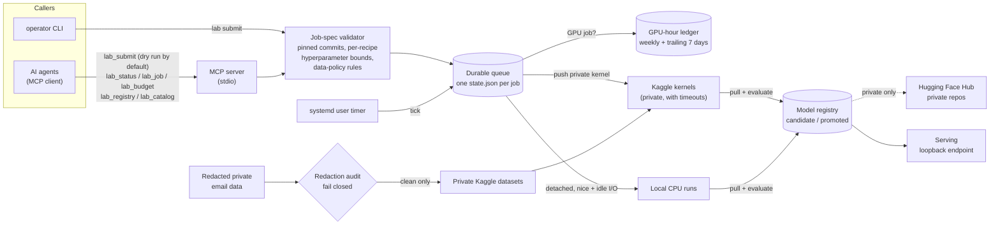

# AI Lab

A small MLOps control tower for training models on free cloud compute. A home server owns the job queue, the GPU-hour budget, the data-privacy gate, evaluation and the model registry. Training runs as private Kaggle kernels or as low-priority local CPU jobs. An MCP server lets AI agents read the lab and submit jobs.

Status: the queue, budget, redaction gate, registry and MCP server are running. Transformer classifiers have been trained and evaluated. The QLoRA LLM fine-tuning recipe is built and unit-tested but has **not** been run yet (details under "Honest status").

## What it does

- **Trains transformer classifiers.** A ModernBERT-base fine-tune (PyTorch + Hugging Face Transformers `Trainer`) and few-shot SetFit / sentence-transformers classifiers, run as Kaggle kernels and locally on CPU, on a public dataset (banking77) and on redacted private email data.
- **Serves its own email classifier.** An inbox classifier trained on redacted private email data is served on a loopback-only endpoint. On held-out items of that data it scores **85% accuracy against 42%** for a local `llama3.2:3b` baseline given the same task, so the server's shared LLM router asks it first for three inbox-classification menus: a confident answer is used as is, and a low-confidence, timed-out or off-menu answer falls through to the router's usual model chain.
- **Prepares LLM fine-tuning.** A QLoRA supervised fine-tuning recipe (Unsloth + TRL + PEFT LoRA adapters on a 4-bit base model, then a merged 16-bit model and a GGUF export) is ready for a Kaggle T4. First run pending.

## Architecture



- **Job spec** (`excerpts/jobspec.py`): a YAML file becomes a frozen, validated `JobSpec`. It fails closed on unknown keys, branch names instead of commit pins, unknown recipes, out-of-bounds or mistyped hyperparameters, and data-policy contradictions. The QLoRA recipe must state its adapter shape, sequence length and step budget.
- **Queue** (`excerpts/job_queue.py`): an explicit state machine with one atomically written `state.json` per job. A systemd user timer runs an idempotent tick that pushes, polls, pulls and evaluates.
- **Budget** (`excerpts/budget_ledger.py`): an append-only ledger of reserved and settled GPU-hours. A GPU job only leaves the queue if it fits under the weekly cap.
- **Redaction audit** (`excerpts/redaction_audit.py`): an independent second check run on redacted text before any upload. Any hit blocks the upload, and the error carries counts and item ids, never the text.
- **Recipes** (`excerpts/sft_recipe.py` shows the QLoRA one): standalone training scripts shipped into Kaggle kernels.
- **MCP server**: exposes status, single-job detail, budget, registry and the pinned model/dataset catalogue to agents. `lab_submit` validates a job and only queues it when the caller turns dry run off. No tool deploys anything.

## Key engineering decisions

### 1. The kernel slug is written to disk before the push
**Decision.** A job moves to `submitted` with its kernel slug saved *before* the push call. A push the remote explicitly refuses un-records the slug, refunds the reservation and requeues. A push that times out keeps the slug and is only ever polled after that, never pushed again.
**Why.** The box can lose power mid-tick. With this order, a restarted tick always knows whether a kernel might exist, so a job is never launched twice and its GPU time is never lost from the ledger.
**Trade-off.** A job whose push really failed with an unknown outcome waits for its polls to fail before it is marked failed.

### 2. Two budget windows, and "unknown" counts as GPU
**Decision.** The ledger checks the calendar quota week *and* the trailing seven days. Both must pass. A job is charged its `max_hours` at push time and settled to actual elapsed time, capped by its timeout, when it ends. A recipe with no known GPU flag is treated as a GPU job.
**Why.** The provider's quota reset day is not documented. The trailing window keeps the lab under its cap even if the assumed reset day is wrong. Reserving up front means two jobs can't both pass the check and then overspend together.
**Trade-off.** Reserving the full timeout is pessimistic: a job can wait for budget that a running kernel will not end up using.

### 3. Own data goes up only after a second, independent audit
**Decision.** A separate step redacts the email text. Then this lab re-scans it with its own detectors (emails, phone numbers, tokenised URLs, Luhn-valid card numbers, mod-97-valid IBANs, and the sender's own name parts) before staging it to a private dataset. Any hit raises an error. The spec validator also stops raw private data from being given any backend other than local, and stops redacted data from being labelled public.
**Why.** A single redactor is a single point of failure. A second detector set written separately catches what the first one misses, and a fail-closed gate means a bug shows up as a blocked upload rather than as a leak.
**Trade-off.** False positives block uploads. The detectors carry explicit exceptions (dates, times, SMTP status codes, IP addresses, role mailboxes, system sender names) that need upkeep.

### 4. Hyperparameters that decide cost are required, not defaulted
**Decision.** For the QLoRA recipe, `lora_r`, `lora_alpha`, `lora_dropout`, `learning_rate`, `max_seq_length` and `max_steps` must be stated in the spec. The validator enforces this at submit time and the recipe enforces it again at run time. Every hyperparameter is type- and range-checked, and `true` is not accepted as `1`.
**Why.** These values decide the GPU-hours a run spends and the adapter it produces. A silent default would spend scarce quota on a run nobody chose.

### 5. The adapter is saved first; exports may fail without losing it
**Decision.** After training, the LoRA adapter is saved first and its failure propagates. The merged 16-bit model and the GGUF export follow, and their failures are recorded rather than raised. Training stops early when a set share of the session timeout has gone, leaving time for the exports.
**Why.** The GGUF step builds llama.cpp inside the kernel and is the most fragile part of the run. The adapter is the irreplaceable output.

### 6. Agents get a dry-run-first interface
**Decision.** The MCP server's read tools only read. `lab_submit` defaults to a dry run that validates and returns. Queueing requires turning dry run off, and the job then still passes the same budget gate as any other.
**Why.** An agent can propose and check training jobs on its own, but it cannot skip validation or the budget, and it cannot deploy anything.

## Honest status

- **Classifiers: ran.** ModernBERT-base and SetFit classifiers trained as Kaggle kernels and as local CPU jobs, and were evaluated into the registry.
- **Kaggle runs so far ran on CPU.** GPU is not yet unlocked on the Kaggle account, so the provider silently runs GPU requests on CPU. The lab detects this and records the device.
- **QLoRA SFT: built, not run.** The recipe and its validation are unit-tested (see `excerpts/tests/test_sft_recipe.py`), but no LLM has been fine-tuned with it yet. It is ready for a T4; first run pending.
- **Classification only.** The served model answers a label and a confidence on loopback; it is not a chat model, and promoting a model never deploys it — wiring one in is a separate, reviewed change.

## What's in this repo

Sanitized excerpts copied from the private source and trimmed so each file stands alone. Each file starts with a header that says what was kept and what was removed.

| File | What to look at |
|---|---|
| [`excerpts/job_queue.py`](excerpts/job_queue.py) | State enum and transition table, atomic `state.json` writes, the non-blocking lock, and the tick: budget gate, slug-before-push, refused vs unknown push outcomes, bounded retries, settling actual hours. |
| [`excerpts/budget_ledger.py`](excerpts/budget_ledger.py) | Append-only, fsync'd reserve/settle ledger; latest-event-wins charging; calendar-week plus trailing-window cap; fail-closed parsing. |
| [`excerpts/redaction_audit.py`](excerpts/redaction_audit.py) | Detectors for emails, phones, tokenised URLs, cards (Luhn), IBANs (mod 97) and sender names; text-free hits; `audit_or_raise`. |
| [`excerpts/jobspec.py`](excerpts/jobspec.py) | Frozen spec records, commit pins, per-recipe hyperparameter bounds, required QLoRA hyperparameters, data-policy and backend rules, dotted-path errors. |
| [`excerpts/sft_recipe.py`](excerpts/sft_recipe.py) | QLoRA recipe: required hyperparameters and defaults merge, ShareGPT/OpenAI chat normalisation, throughput metric, session time budget, pinned runtime install, adapter-first export. The training function is included but untested. |
| [`excerpts/tests/`](excerpts/tests/) | pytest tests (Arrange, Act, Assert) for every excerpt, with fake backends, clocks and models. No network, GPU or ML libraries needed. |

Run the tests (needs `pytest`; the job-spec tests also need `PyYAML` and are skipped without it):

```bash
python3 -m pytest excerpts -q
```

## Tech stack

- Python, PyTorch, Hugging Face Transformers, SetFit / sentence-transformers
- Unsloth, TRL, PEFT (QLoRA, 4-bit base, LoRA adapters), GGUF export
- Kaggle kernels and datasets (private), via the official `kaggle` CLI
- Hugging Face Hub (pinned model/dataset commits, private artifact repos)
- MCP (stdio server for agents)
- systemd user timer, JSON state files, append-only JSON-lines ledger
- Ollama (`llama3.2:3b` as the local baseline), pytest, PyYAML

## About

Built and operated by Muhammad H.M. Alvi. Contact: info@aethonautomation.com · https://github.com/mhmalvi

The full source is private. The files in this repository are sanitized excerpts of it.
